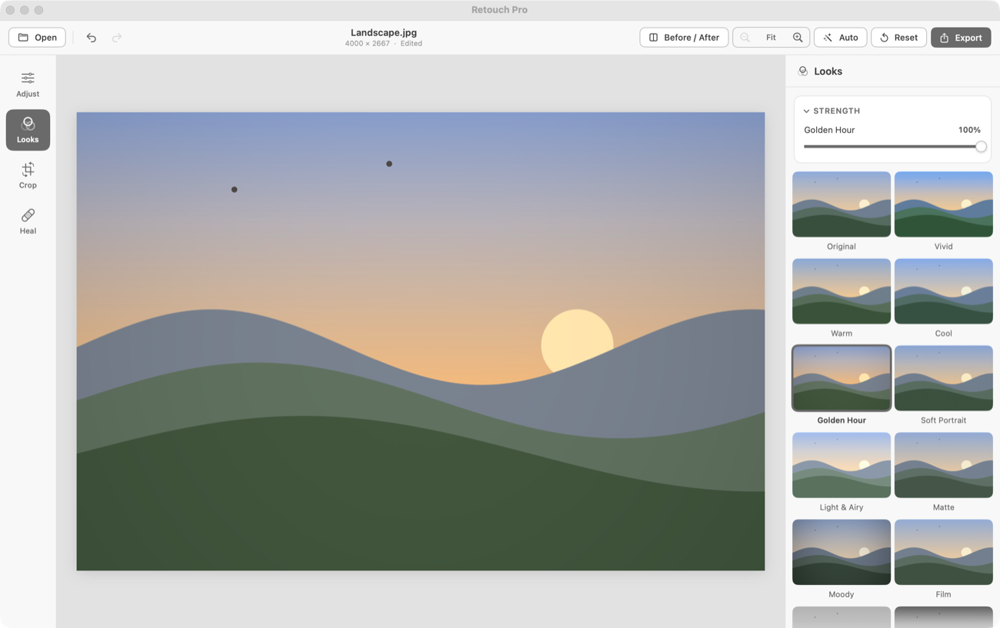
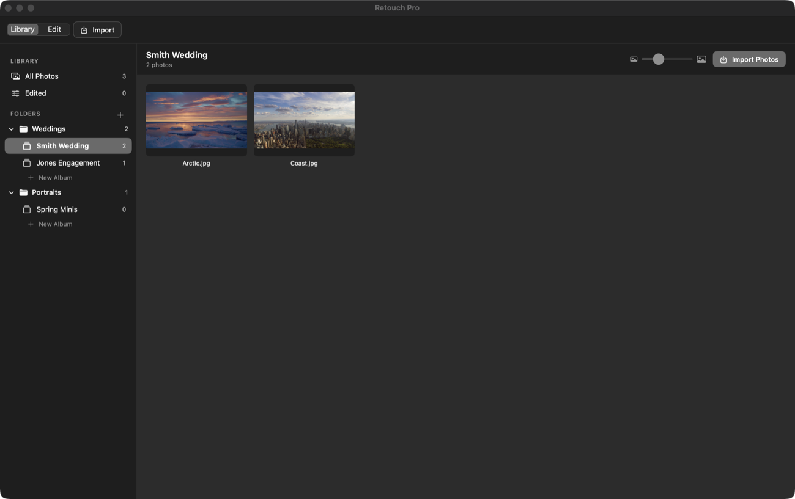
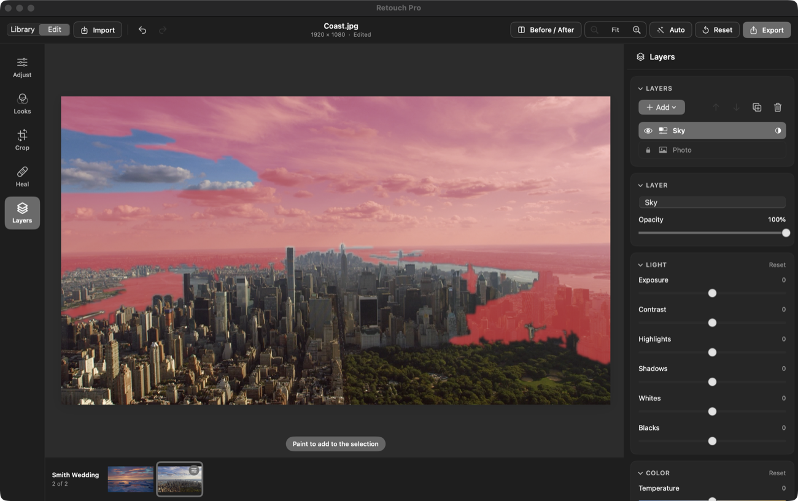
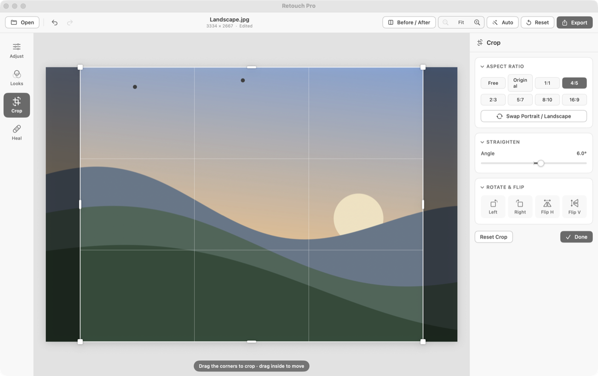
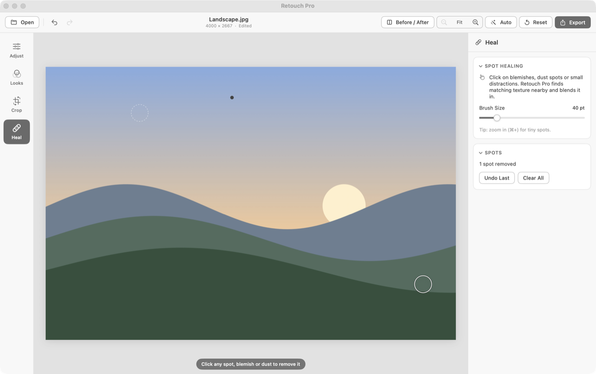
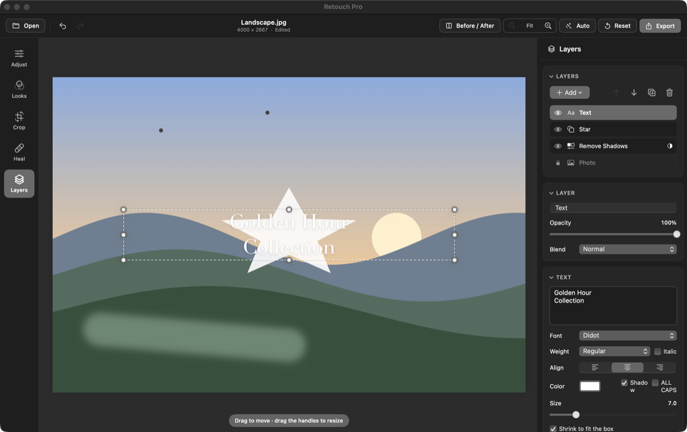

# Retouch Pro

A simple, friendly photo editor for the Mac. It's built for photographers who want the good parts of a pro editor without the learning curve.



## Download & install

1. Go to **[Releases](../../releases/latest)** and download **RetouchPro.zip**.
2. Double-click the zip, then drag **Retouch Pro** into your **Applications** folder.
3. **The first time only:** macOS blocks apps that aren't from the App Store or a paid Apple developer account. To let it through:
   - Double-click Retouch Pro. When macOS says it can't verify the app, click **Done** (or **Cancel**).
   - Open **System Settings → Privacy & Security**, scroll down, and click **Open Anyway** next to "Retouch Pro was blocked".
   - Confirm with your password or Touch ID. From then on it opens normally.

   *Alternative (Terminal):* `xattr -dr com.apple.quarantine "/Applications/Retouch Pro.app"`

Works on macOS 13 Ventura or newer, on both Apple Silicon and Intel Macs.

## What it does

| Tool | What you can do |
|---|---|
| **Adjust** | Exposure, Contrast, Highlights, Shadows, Whites, Blacks · Temperature, Tint, Vibrance, Saturation · Remove Shadows, Tame Sun Spots, Fade Skin Spots · Clarity, Sharpen, Noise Reduction · Vignette, Grain, Fade · live histogram · **Auto Enhance** (Signature or Natural style) |
| **Looks** | 16 one-click presets (Golden Hour, Soft Portrait, Light & Airy, Moody, Film, Mono, Noir…) with a strength slider, layered on top of your own adjustments |
| **Crop** | Drag-to-crop with rule-of-thirds grid · 1:1, 4:5, 2:3, 5:7, 8:10, 16:9 and more · Straighten · Rotate · Flip |
| **Heal** | Click a blemish or dust spot, or brush over a larger distraction. Retouch Pro copies clean texture from nearby and blends its light and color in seamlessly |
| **Library** | Cull with **Pick / Reject / Unflag** (P, X, U) and filter by flag · Import many photos (or whole folders) at once · Folders with albums inside (e.g. *Weddings ▸ Smith Wedding*) · Drag photos onto albums · Edits are saved automatically per photo, and the filmstrip lets you move between photos while editing |
| **Layers** | Adjustment layers with masks: **automatic selection of people, sky, subject or background** (click a person to leave them out), or brush, gradient and radial masks · Remove Shadows, Tame Sun Spots and Fade Skin Spots layers you paint where needed · Text that re-flows and scales with your crop · Shapes (rectangle, ellipse, line, triangle, star) · Pen-tool paths with smooth curves · Opacity and blend modes |
| **Export** | JPEG, HEIC, PNG or 16-bit TIFF · full size or web/social sizes · sRGB or Display P3 · keeps EXIF/copyright · optional watermark |

Other things:

- **Opens camera RAW** files (CR2, CR3, NEF, ARW, DNG, RAF, ORF…) as well as JPEG, HEIC, PNG and TIFF.
- **Non-destructive.** Your original file is never changed. Edits are saved in Retouch Pro's library, and Export saves a new copy.
- **Mask highlight** shows what's selected, then hides itself as soon as you adjust so you can see the edit (press O to bring it back).
- **Private.** People and subject detection uses Apple's on-device Vision models. Nothing is uploaded.
- **Before / After.** Press and hold the button, or press ⌘\ to toggle.
- **Unlimited undo.** ⌘Z / ⇧⌘Z.
- **Light or dark mode**, and default export settings, in **Settings** (⌘,).
- **Built-in updates.** Settings ▸ Updates (or Retouch Pro ▸ Check for Updates…) checks GitHub; **Update Now** downloads the new version, installs it and restarts. No need to re-download or re-approve it manually.
- **Signature Auto Enhance**: a bright, airy, warm look with soft blacks, tuned from a professional wedding & portrait portfolio. Switch to a neutral "Natural" style in Settings.
- **Copy & paste edits** between photos (⇧⌘C, then open the next photo and press ⇧⌘V).
- Drag a photo onto the window, or right-click a photo in Finder → **Open With → Retouch Pro**.

### Keyboard shortcuts

Retouch Pro uses the same keys as Photoshop and Lightroom where they apply. Press **⌥⇧⌘K** (Help ▸ Keyboard Shortcuts) for the full list. Single-letter keys never fire while you're typing in a text box.

| | |
|---|---|
| Adjust · Crop · Heal · Layers | E (or D) · C · J (or S) · V |
| Pick · Reject · Unflag | P · X · U |
| Previous / next photo | ← / → |
| Library grid / Library ⇄ Editor | G / ⌘L |
| White balance picker | W, then click something neutral |
| Auto Enhance | ⇧A |
| New text · rectangle · brush mask · gradient · radial | T · M · B · L · R |
| Show / hide mask overlay · change its color | O · ⇧O |
| Brush smaller / larger | [ / ] (hold ⌥ while painting to erase) |
| Show original | \ |
| Zoom: toggle Fit/100% · Fit · 100% · 200% | Space · ⌘0 · ⌘1 · ⌘2 |
| Full screen · filmstrip | F · / |
| Duplicate layer · invert mask | ⌘J · ⌘I |
| Layer to front / back · select top / bottom layer | ⌥⌘] / ⌥⌘[ · ⌥. / ⌥, |
| Undo / redo | ⌘Z / ⇧⌘Z |
| Copy / paste edit settings | ⇧⌘C / ⇧⌘V |
| Import · export · settings | ⌘O (⇧⌘I) · ⌘E (⇧E) · ⌘, (⌘K) |
| New folder / album | ⇧⌘N / ⌥⌘N |







## Building from source

You need the Xcode Command Line Tools (`xcode-select --install`) or Xcode.

```bash
./scripts/build.sh 1.0.0
```

This makes `dist/Retouch Pro.app` (Apple Silicon + Intel) and `dist/RetouchPro.zip`. For quick development runs, use `swift run`.

The app is written in SwiftUI with a Core Image processing pipeline:

- `Sources/RetouchPro/ImagePipeline.swift`: loading (including RAW), geometry, adjustments, looks, effects, export helpers
- `Sources/RetouchPro/HealEngine.swift`: finds clean source texture and builds the seamless color-blend field for healing
- `Sources/RetouchPro/LayerRenderer.swift`: adjustment layers, masks, text, shapes and pen paths
- `Sources/RetouchPro/AutoMasking.swift`: automatic people / subject (Vision) and sky / background selection
- `Sources/RetouchPro/Library.swift`: photo catalog, folders, albums, saved edits, thumbnails
- `Sources/RetouchPro/EditorModel.swift`: editing state, undo history, live preview rendering, export
- `Sources/RetouchPro/Views/`: the interface
- `Sources/RetouchPro/Theme.swift`: the grayscale palette (#6A6A6A, #979797, #BDBDBD, #E2E2E2, #F8F8F8)

### Publishing a new version

```bash
./scripts/build.sh 1.1.0
gh release create v1.1.0 dist/RetouchPro.zip --title "Retouch Pro 1.1.0" --notes "What's new…"
```

To skip the "Open Anyway" step for people you share with, the app needs to be signed and notarized with an Apple Developer ID ($99/year Apple Developer Program).
